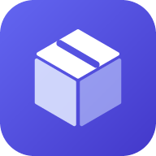
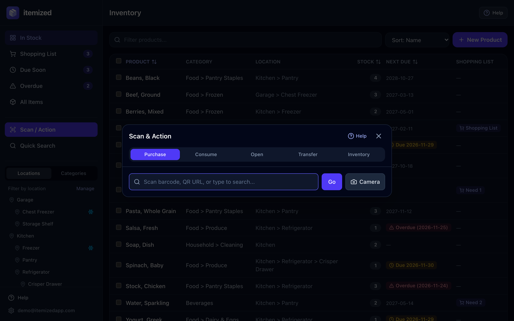
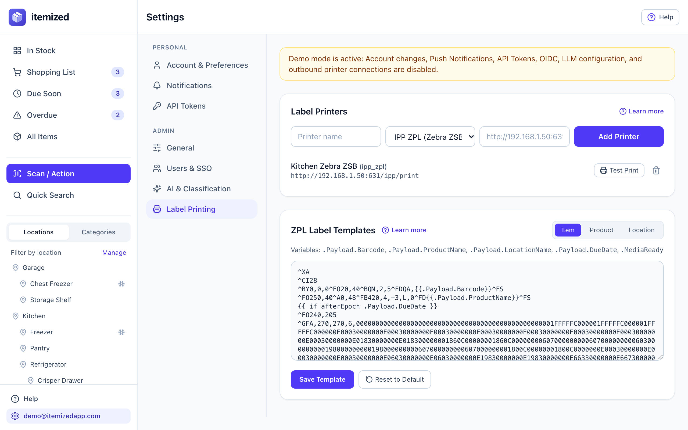
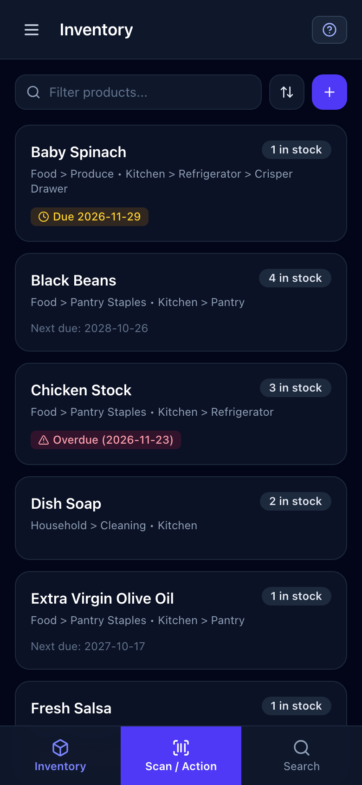

<!-- Generated from docs/ by `make docs-build`. Do not edit by hand; update files under docs/ or web/scripts/docs/readme.ts instead. -->

<p align="center">
  
</p>

<h1 align="center">itemized</h1>

<p align="center">
  <strong>Self-hosted household inventory management, expiration tracking, barcode scanning, and direct Zebra ZPL label printing.</strong>
</p>

<p align="center">
  <a href="https://demo.itemizedapp.com"><strong>🚀 Try the Live Demo</strong></a>
  &nbsp;·&nbsp;
  <a href="docs/get-started/getting-started.md">User Guide</a>
  &nbsp;·&nbsp;
  <a href="docs/self-hosting/README.md">Self-Hosting</a>
  &nbsp;·&nbsp;
  <a href="docs/api.md">API</a>
  &nbsp;·&nbsp;
  <a href="CONTRIBUTING.md">Contributing</a>
</p>

<p align="center">
  <sub>No login required on the live demo — sample household data resets automatically every hour.</sub>
</p>

<p align="center">
  
</p>

---

## What itemized does

Itemized is designed to make tracking everything in your pantry, fridge, freezers, and storage shelves fast and effortless—from your phone at the grocery store or a desktop with a USB barcode scanner.

- **[Inventory and expiration tracking](docs/use/inventory-and-expiration.md)**: Track stock quantities, Due Soon and Overdue alerts, rolling-average due dates, and bulk item actions.
- **[Locations and categories](docs/use/locations-and-categories.md)**: Organize storage areas and product categories in nested trees, mark freezers, and print location QR labels.
- **[Barcode scanning and workflows](docs/use/barcode-scanning.md)**: Use your phone camera or a USB/Bluetooth scanner to Purchase, Consume, Open, Transfer, and Audit stock.
- **[Variants and barcodes](docs/use/variants-and-barcodes.md)**: Group brands and package sizes under one product, attach multiple barcodes, and merge duplicate products.
- **[UPC lookup and AI classification](docs/use/upc-and-ai.md)**: Automatically look up unknown retail barcodes via OpenFoodFacts and optionally normalize names with an LLM.
- **[Shopping list and minimum stock](docs/use/shopping-list.md)**: Surface low-stock items automatically, pin products manually, and auto-clear them when restocked.
- **[Label printing and ZPL templates](docs/use/label-printing.md)**: Print scannable QR labels directly to Zebra ZSB (IPP) and Raw TCP (:9100) ZPL printers on your LAN.
- **[Search and keyboard shortcuts](docs/use/search-and-shortcuts.md)**: Find products instantly with typo-tolerant FTS5 search and navigate desktop views with Gmail-style shortcuts.
- **[Household accounts and OIDC SSO](docs/use/accounts-and-sso.md)**: Manage household users, Admin and Member roles, passwords, and optional OpenID Connect single sign-on.
- **[Settings overview](docs/use/settings.md)**: Navigate Account, Instance Configuration, OIDC, AI classification, Household Users, Printers, and ZPL Templates.

---

## Screenshots

<table>
  <tr>
    <td align="center" width="50%">
      <a href="docs/use/barcode-scanning.md"></a><br />
      <strong><a href="docs/use/barcode-scanning.md">Barcode scanning and workflows</a></strong>
    </td>
    <td align="center" width="50%">
      <a href="docs/use/shopping-list.md"></a><br />
      <strong><a href="docs/use/shopping-list.md">Shopping list and minimum stock</a></strong>
    </td>
  </tr>
  <tr>
    <td align="center" width="50%">
      <a href="docs/use/inventory-and-expiration.md"></a><br />
      <strong><a href="docs/use/inventory-and-expiration.md">Inventory and expiration tracking</a></strong>
    </td>
    <td align="center" width="50%">
      <a href="docs/use/label-printing.md"></a><br />
      <strong><a href="docs/use/label-printing.md">Label printing and ZPL templates</a></strong>
    </td>
  </tr>
</table>

<p align="center">
  <a href="docs/get-started/install-pwa.md"></a><br />
  <strong><a href="docs/get-started/install-pwa.md">Install itemized on your phone</a></strong>
</p>

---

## Quick Start

Pre-built multi-architecture images (`linux/amd64` and `linux/arm64`) are published to GitHub Container Registry at `ghcr.io/itemizedapp/itemized:latest`.

### Docker Compose (Recommended)

```yaml
services:
  itemized:
    image: ghcr.io/itemizedapp/itemized:latest
    container_name: itemized
    restart: unless-stopped
    ports:
      - "8080:8080"
    volumes:
      - ./data:/data
    environment:
      BASE_URL: https://itemized.example.com
      TRUST_PROXY: "true"
      TZ: America/New_York
```

```bash
docker compose up -d
```

### Docker Run

```bash
docker run -d \
  --name itemized \
  --restart unless-stopped \
  -p 8080:8080 \
  -v /path/to/appdata/itemized:/data \
  -e BASE_URL=https://itemized.example.com \
  -e TRUST_PROXY=true \
  -e TZ=America/New_York \
  ghcr.io/itemizedapp/itemized:latest
```

Open `http://localhost:8080` (or your reverse-proxy URL) to complete first-run administrator setup.

### Other Deployment Options

| Platform | Guide | Best for |
| --- | --- | --- |
| Docker Compose | [Docker Compose](docs/self-hosting/docker-compose.md) | Recommended for Linux servers and homelabs |
| Docker Run | [Docker Run](docs/self-hosting/docker-run.md) | Quick single-container deployments |
| Unraid | [Unraid Community Apps](docs/self-hosting/unraid.md) | Unraid NAS appliances using the Community Apps template in [itemizedapp/itemized-unraid](https://github.com/itemizedapp/itemized-unraid) |
| Single Binary | [Single Binary](docs/self-hosting/binary.md) | Bare-metal Linux/macOS or systemd without containers |

---

## HTTPS & Reverse Proxy

Modern mobile browsers (including iOS Safari and Chrome/Firefox on iOS) disable camera access (`navigator.mediaDevices`) on plain `http://` LAN URLs. Serve itemized over **HTTPS** behind a reverse proxy (Caddy, nginx, Traefik, or Tailscale Serve) with `TRUST_PROXY=true` and `BASE_URL=https://itemized.example.com`.

See [Reverse proxy and TLS](docs/self-hosting/README.md#3-reverse-proxy-and-tls) for ready-to-use Caddy, nginx, and Traefik configurations.

---

## Configuration

**No environment variable is mandatory.** Settings marked **Editable in UI** can be changed anytime under **Settings → Instance Configuration**; values saved in the database take precedence over environment variable defaults. See [Configuration reference](docs/self-hosting/configuration.md) for full details.

| Variable | Default | Example | Editable in UI | Explained in |
| --- | --- | --- | --- | --- |
| `PORT` | `8080` | `8080` | No | [Self-hosting handbook](docs/self-hosting/README.md) |
| `DB_PATH` | `/data/itemized.db` | `/data/itemized.db` | No | [Backups and restore drill](docs/self-hosting/README.md#4-backups-and-restore-drill) |
| `PUID` | `1000` | `99` | No | [Unraid Community Apps](docs/self-hosting/unraid.md) |
| `PGID` | `1000` | `100` | No | [Unraid Community Apps](docs/self-hosting/unraid.md) |
| `BASE_URL` | *(request host)* | `https://itemized.example.com` | Yes | [Reverse proxy and TLS](docs/self-hosting/README.md#3-reverse-proxy-and-tls) |
| `TRUST_PROXY` | `false` | `true` | No | [Reverse proxy and TLS](docs/self-hosting/README.md#3-reverse-proxy-and-tls) |
| `OIDC_ISSUER` | *(disabled)* | `https://auth.example.com/application/o/itemized/` | Yes | [Household accounts and OIDC SSO](docs/use/accounts-and-sso.md) |
| `OIDC_CLIENT_ID` | *(empty)* | `itemized-client` | Yes | [Household accounts and OIDC SSO](docs/use/accounts-and-sso.md) |
| `OIDC_CLIENT_SECRET` | *(empty)* | `secret-value` | Yes | [Household accounts and OIDC SSO](docs/use/accounts-and-sso.md) |
| `OIDC_AUTO_PROVISION` | `false` | `true` | Yes | [Household accounts and OIDC SSO](docs/use/accounts-and-sso.md) |
| `OIDC_FORCE` | `false` | `true` | Yes | [Household accounts and OIDC SSO](docs/use/accounts-and-sso.md) |
| `LLM_PROVIDER` | *(disabled)* | `openai-compatible` | Yes | [UPC lookup and AI classification](docs/use/upc-and-ai.md) |
| `LLM_MODEL` | *(empty)* | `llama3.2` | Yes | [UPC lookup and AI classification](docs/use/upc-and-ai.md) |
| `LLM_BASE_URL` | *(provider default)* | `http://ollama:11434/v1` | Yes | [UPC lookup and AI classification](docs/use/upc-and-ai.md) |
| `LLM_API_KEY` | *(empty)* | `sk-...` | Yes | [UPC lookup and AI classification](docs/use/upc-and-ai.md) |
| `DEMO_MODE` | `false` | `true` | No | [Demo mode](docs/get-started/demo-mode.md) |
| `DEMO_RESET_INTERVAL` | `1h` | `30m` | No | [Demo mode](docs/get-started/demo-mode.md) |

---

## Development

```bash
# Run docs checks, Go vet/tests, and frontend tests
make check

# Build full single binary (embeds web/dist)
make build

# Regenerate static docs, in-app Help, and README.md
make docs-build

# Run locally in demo mode
DEMO_MODE=true DB_PATH=/tmp/itemized-demo.db go run ./cmd/itemized

# Build Docker image locally
docker build -t itemized:local .
```

See [CONTRIBUTING.md](CONTRIBUTING.md) for the contributor guide, architecture tour, and package map.

---

## AI-Assisted Development & OpenSpec

AI coding assistants are actively used in the development of itemized—helping author specifications, code, tests, and documentation—under human direction and review. To keep changes intentional and reliable, itemized follows a spec-driven workflow with **OpenSpec** (`openspec/`):

- **Spec-first planning**: Changes are proposed, specified, and reviewed before implementation begins.
- **Living specifications**: Archived changes update `openspec/specs/` so humans and AI agents always share an authoritative behavioral contract.
- **Automated verification**: All changes are validated with `make check` (Go tests/vet, API doc contract checks, Vitest frontend tests, and docs/link/freshness checks).

Learn more in the [OpenSpec workflow guide](docs/contributing/openspec.md).

---

## Security

To report a security vulnerability, please see [SECURITY.md](SECURITY.md).

## License

itemized is licensed under the [GNU Affero General Public License v3.0 (AGPL-3.0)](LICENSE).
