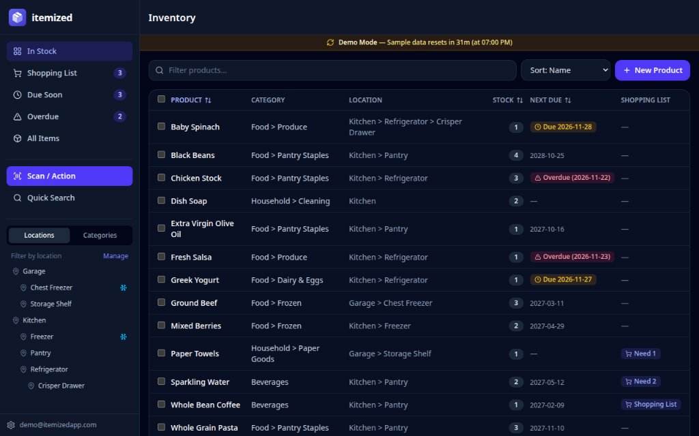

<p align="center">
  
</p>

<h1 align="center">Itemized</h1>

<p align="center">
  <strong>Self-hosted household inventory management, expiration tracking, barcode scanning, and direct Zebra ZPL label printing.</strong>
</p>

<p align="center">
  <a href="https://demo.itemizedapp.com"><strong>🚀 Try the Live Demo</strong></a>
  &nbsp;·&nbsp;
  <a href="#quick-start">Quick Start</a>
  &nbsp;·&nbsp;
  <a href="#configuration">Configuration</a>
  &nbsp;·&nbsp;
  <a href="#unraid-community-apps">Unraid</a>
</p>

<p align="center">
  <sub>No login required on the live demo — sample household data resets automatically every hour.</sub>
</p>

<p align="center">
  
</p>

---

## What Itemized Does

Itemized is designed to make tracking everything in your pantry, fridge, freezers, and storage shelves fast and effortless—from your phone at the grocery store or a desktop with a USB barcode scanner.

- **Track Stock & Expiration Dates**: Organize items into nested **Locations** (such as *Kitchen → Refrigerator → Crisper Drawer* or *Garage → Chest Freezer*) and **Categories**. Automatically highlights **Due Soon** and **Overdue** items, with smart due-date rules for opening, freezing, thawing, and rolling-average consumption history.
- **Automatic Shopping List**: Set minimum stock levels on products to automatically surface low-stock items on your **Shopping List**, add items manually with one click, and have them clear automatically once restocked.
- **Mobile & USB Barcode / QR Scanning**: Use your phone's camera (installable as a mobile PWA) or a USB/Bluetooth scanner in the unified **Scan / Action** workflow to **Purchase**, **Consume**, **Open**, **Transfer**, or run a **Location Inventory Audit**. Unknown retail barcodes automatically look up product details via OpenFoodFacts, with optional AI-assisted naming and categorization (Anthropic, OpenAI, Gemini, or local Ollama).
- **Direct LAN Label Printing**: Print QR labels directly to **Zebra ZSB** (IPP) and **Raw TCP (`:9100`) ZPL** printers on your local network—no companion print server needed—with customizable Go-template ZPL layouts for items, products, and locations.
- **Instant Search & Keyboard Shortcuts**: Typo-tolerant SQLite FTS5 trigram search plus Gmail-style desktop shortcuts (`g i`, `g s`, `g d`, `g o`, `g a`, `n`, `?`).
- **Household Accounts & SSO**: Supports multiple household users with **Admin** and **Member** roles, local password auth, and optional **OIDC SSO** (Authentik, Authelia, Pocket ID, Keycloak, etc.) with auto-provisioning.
- **Zero-Dependency Self-Hosting**: Ships as a single Go binary with an embedded React SPA and a single SQLite database file (`WAL` mode)—multi-arch (`linux/amd64` and `linux/arm64`) with an Unraid Community Apps template included.

---

## Quick Start

Pre-built multi-architecture images (`linux/amd64` and `linux/arm64`) are published to GitHub Container Registry at `ghcr.io/itemizedapp/itemized:latest`.

### Docker Compose (Recommended)

```yaml
services:
  itemized:
    image: ghcr.io/itemizedapp/itemized:latest
    container_name: itemized
    restart: unless-stopped
    ports:
      - "8080:8080"
    volumes:
      - ./data:/data
    environment:
      BASE_URL: https://itemized.example.com
      TRUST_PROXY: "true"
      TZ: America/New_York
```

```bash
docker compose up -d
```

### Docker Run

```bash
docker run -d \
  --name itemized \
  --restart unless-stopped \
  -p 8080:8080 \
  -v /path/to/appdata/itemized:/data \
  -e BASE_URL=https://itemized.example.com \
  -e TRUST_PROXY=true \
  -e TZ=America/New_York \
  ghcr.io/itemizedapp/itemized:latest
```

Open `http://localhost:8080` (or your reverse-proxy URL) to complete first-run administrator setup.

---

## HTTPS & Reverse Proxy (Required for Mobile Barcode Scanning)

Modern mobile browsers (including iOS Safari and Chrome/Firefox on iOS) disable the camera API (`navigator.mediaDevices`) on plain `http://` LAN URLs such as `http://192.168.1.x:8080`. To use live camera barcode scanning on phones and tablets, serve Itemized over **HTTPS** by placing it behind a reverse proxy (such as Nginx Proxy Manager, Caddy, Traefik, SWAG, or Tailscale Serve).

When running behind a reverse proxy, set:

- `TRUST_PROXY=true` so rate limiting reads client IPs from `X-Forwarded-For` / `X-Real-IP`.
- `BASE_URL=https://itemized.example.com` so printed QR labels encode your HTTPS URL.

---

## Configuration

All instance settings (except `PORT`, `DB_PATH`, `PUID`/`PGID`, `TRUST_PROXY`, and `DEMO_*`) can also be edited in **Settings** after first-run setup.

| Variable | Default | Description |
|---|---|---|
| `PORT` | `8080` | HTTP listen port |
| `DB_PATH` | `/data/itemized.db` | SQLite database path |
| `PUID` | `1000` | User ID for running Itemized and owning `/data` (`99` in Unraid template) |
| `PGID` | `1000` | Group ID for running Itemized and owning `/data` (`100` in Unraid template) |
| `BASE_URL` | *(request host)* | Base URL encoded into printed QR labels |
| `TRUST_PROXY` | `false` | Set to `true` behind a reverse proxy so rate limiting uses `X-Forwarded-For` / `X-Real-IP` |
| `OIDC_ISSUER` | *(disabled)* | Optional OIDC issuer URL (Auth Code + PKCE) |
| `OIDC_CLIENT_ID` | | Optional OIDC client ID |
| `OIDC_CLIENT_SECRET` | | Optional OIDC client secret |
| `OIDC_AUTO_PROVISION` | `false` | Auto-create `member` accounts on first OIDC login |
| `OIDC_FORCE` | `false` | Require OIDC sign-in (redirect login page to IdP and disable local password login) |
| `LLM_PROVIDER` | *(disabled)* | `anthropic`, `openai`, `gemini`, or `openai-compatible` |
| `LLM_MODEL` | | LLM model name for optional UPC normalization |
| `LLM_BASE_URL` | | Custom endpoint (e.g. `http://ollama:11434/v1`) |
| `LLM_API_KEY` | | API key for the configured LLM provider |
| `DEMO_MODE` | `false` | Set to `true` to run in public demo mode (bypasses login as demo admin, seeds sample household data, sandboxes outbound printer/OIDC/LLM calls, rate-limits UPC lookup to 5/min) |
| `DEMO_RESET_INTERVAL` | `1h` | Reset interval for demo mode (Go duration, aligned to wall-clock boundaries) |

---

## Unraid Community Apps

An Unraid template is provided at [unraid/itemized.xml](unraid/itemized.xml). Bridge networking reaches LAN printers directly on outbound connections (e.g. `http://192.168.1.50:631/ipp/print` for Zebra ZSB or `192.168.1.50:9100` for Raw TCP ZPL printers).

The container entrypoint automatically ensures `/data` ownership matches `PUID:PGID` (`99:100` / `nobody:users` in the Unraid template, or `1000:1000` by default) before dropping privileges to run `/usr/local/bin/itemized` as a non-root user. If launched with an explicit non-root `--user` flag, privilege dropping is skipped automatically.

---

## Development

```bash
# Backend tests
go test ./...

# Frontend tests & build
cd web && npm test && npm run build

# Build full single binary (embeds web/dist)
go build ./cmd/itemized

# Run locally in demo mode
DEMO_MODE=true DB_PATH=/tmp/itemized-demo.db go run ./cmd/itemized

# Build Docker image locally
docker build -t itemized:local .
```
