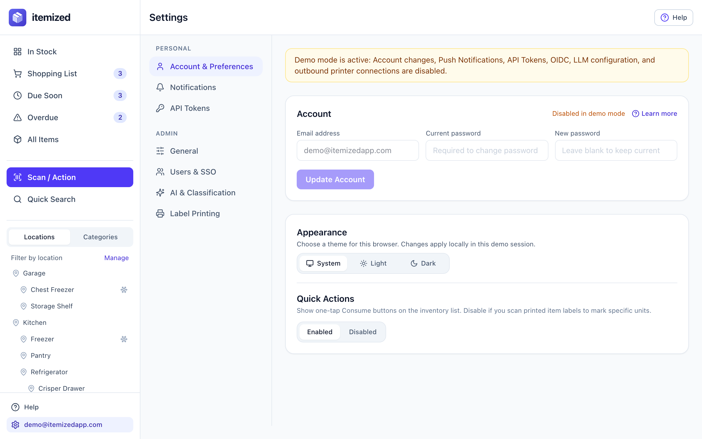

Itemized supports multiple household members with **Admin** and **Member** roles, local password login, and optional OIDC single sign-on.

## Updating your own account and preferences

Every user can open **Settings → Account & Preferences** to:

- Update their email address or change their password (enter your current password and a new password of at least 8 characters).
- Choose an **Appearance** theme (**System**, **Light**, or **Dark**).
- Switch **Quick Actions** between **Enabled** and **Disabled** (enabled by default; disable if you scan printed item labels and prefer marking specific units consumed).

## Managing household users

Administrators can open **Settings → Users & SSO** and use the **Household Users** card to:

- Add new household members with an email address, temporary password, and role (**Member** or **Admin**).
- Promote or demote existing users between **Member** and **Admin**.
- Delete accounts that no longer need access.

Members can browse, scan, and manage inventory, categories, and locations; only Admins can access the **Admin** settings panels (General, Users & SSO, AI & Classification, and Label Printing).

## Connecting OIDC SSO

Under **Settings → Users & SSO → OIDC Single Sign-On (Optional)**, enter your identity provider's **Issuer URL**, **Client ID**, and **Client Secret** (works with Authentik, Authelia, Pocket ID, Keycloak, and other Authorization Code + PKCE providers). Set your provider's redirect URI to `<BASE_URL>/api/auth/oidc/callback`.

Once Issuer URL and Client ID are set, you can optionally enable:

- **Auto-provision new household members on OIDC login** to create `member` accounts automatically on first sign-in.
- **Force OIDC login** to redirect the login screen directly to your IdP and disable local password sign-in.

Select **Save OIDC Settings** to apply your changes.
