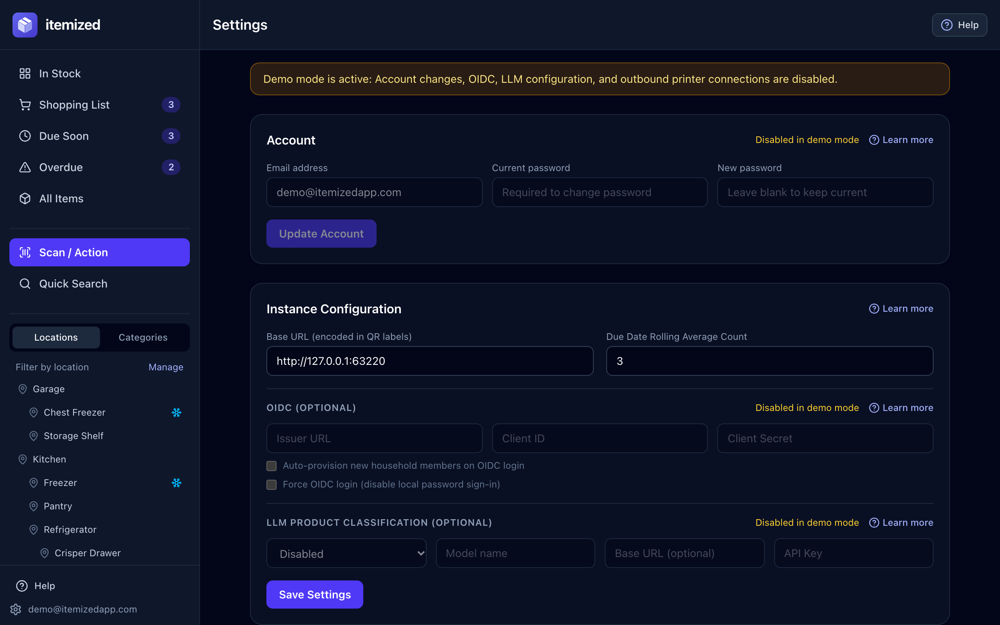

Personal API Tokens let external tools—such as **Home Assistant**, **iOS Shortcuts**, **Mealie/Tandoor bridges**, or shell scripts—authenticate with itemized without relying on short-lived browser cookies or local password login (even when **Force OIDC** is enabled).

## Creating and revoking tokens

1. Open **Settings** and scroll to **API Tokens**.
2. Enter a descriptive **Token name** (for example, `Home Assistant`) and choose an optional expiration (`Never expires`, `30 days`, `90 days`, or `1 year`).
3. Select **Create Token** and copy the `itm_...` value immediately—for security, itemized stores only a SHA-256 hash and will not show the plaintext token again.
4. Pass the token in the `Authorization` header of any `/api/*` request:

```bash
curl -H "Authorization: Bearer itm_your_token_here" \
  https://itemized.example.com/api/summary
```

Tokens inherit your account's role (**Member** or **Admin**) and survive web logouts and password rotations. If a device or key is ever compromised, click **Revoke** next to the token in **Settings → API Tokens** to invalidate it immediately.

## Home Assistant integration

Itemized provides a dedicated `GET /api/summary` endpoint that returns stock, expiration, and shopping-list counts alongside lightweight product lists in a single JSON response. You can poll it with Home Assistant's built-in **REST** integration—no custom HACS component required.

Add your token to Home Assistant's `secrets.yaml`:

```yaml
itemized_api_token: "Bearer itm_your_token_here"
```

Then add a `rest:` block to `configuration.yaml`:

```yaml
rest:
  - resource: https://itemized.example.com/api/summary
    scan_interval: 300
    headers:
      Authorization: !secret itemized_api_token
    sensor:
      - name: "Itemized Due Soon"
        unique_id: itemized_due_soon
        value_template: "{{ value_json.counts.due_soon }}"
        json_attributes:
          - due_soon_products
        icon: mdi:clock-alert-outline

      - name: "Itemized Overdue"
        unique_id: itemized_overdue
        value_template: "{{ value_json.counts.overdue }}"
        json_attributes:
          - overdue_products
        icon: mdi:alert-circle-outline

      - name: "Itemized Shopping List"
        unique_id: itemized_shopping_list
        value_template: "{{ value_json.counts.shopping_list }}"
        json_attributes:
          - shopping_list_products
        icon: mdi:cart-outline

      - name: "Itemized In Stock Items"
        unique_id: itemized_in_stock_items
        value_template: "{{ value_json.counts.in_stock_items }}"
        icon: mdi:package-variant-closed
```

### Example daily expiration alert automation

```yaml
automation:
  - alias: "Itemized: Daily expiring food digest"
    trigger:
      - platform: time
        at: "08:30:00"
    condition:
      - condition: template
        value_template: >
          {{ (states('sensor.itemized_overdue') | int(0)) > 0
             or (states('sensor.itemized_due_soon') | int(0)) > 0 }}
    action:
      - service: notify.mobile_app_your_phone
        data:
          title: "Pantry check"
          message: >
            {{ states('sensor.itemized_overdue') }} overdue and
            {{ states('sensor.itemized_due_soon') }} due soon in itemized.
```

## iOS Shortcuts and scripts

Use the **Get Contents of URL** action in Apple Shortcuts with header `Authorization: Bearer itm_...` to:

- Check what is expiring today via `GET /api/summary`.
- Search your pantry by name or barcode via `GET /api/products?status=all&q=milk`.
- Quick-consume the next-due unit of a product via `POST /api/products/{id}/consume-next`.
- Pin a product to your shopping list via `POST /api/products/{id}/toggle-shopping-list`.

See the [HTTP API reference](../api.md) for the complete list of verified endpoints.
