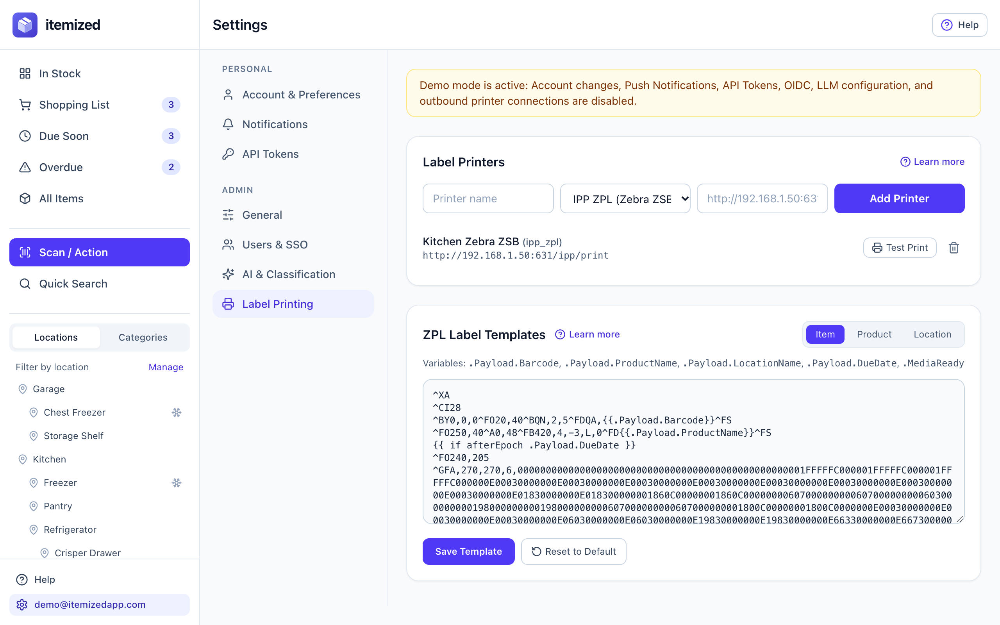

Itemized prints ZPL QR labels directly from the Go server to printers on your local network—no companion print server or browser plugin required.

## Adding a label printer

1. Open **Settings → Label Printers** (Admin only).
2. Enter a **Printer name** and choose a driver:
   - **IPP ZPL (Zebra ZSB)**: Endpoint such as `http://192.168.1.50:631/ipp/print`.
   - **Raw TCP :9100 ZPL**: Endpoint such as `192.168.1.50:9100`.
3. Select **Add Printer**, then click **Test Print** to verify connectivity.

Make sure your **Base URL** in **Settings → Instance Configuration** is set to your HTTPS address so printed QR codes encode the right URL.

## Choosing a product label mode

Each product has a **Label Mode** controlling what prints during **Purchase**:

- **No automatic label** (`none`)
- **One label per item** (`per_item`) — unique `/go/i/:id` QR per physical unit
- **One product label** (`per_product`) — reusable `/go/p/:id` QR for the product

You can also reprint item, product, or location labels anytime from their detail pages.

## Customizing ZPL templates

Under **Settings → ZPL Label Templates**, switch between **item**, **product**, and **location** templates. Templates use Go `text/template` syntax with variables including `.Payload.Barcode`, `.Payload.ProductName`, `.Payload.LocationName`, `.Payload.DueDate`, and `.MediaReady`. Select **Reset to Default** anytime to restore the built-in template.
