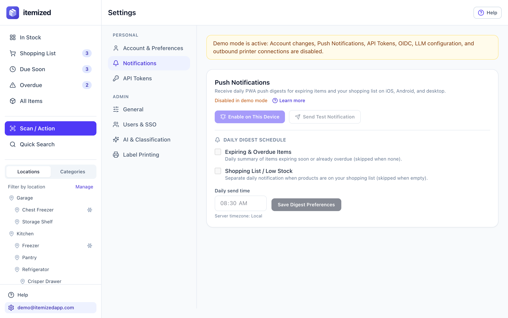

Itemized sends per-user daily digest push notifications directly to your phone or desktop browser using standard Web Push (VAPID)—no external push service account or API key required.

## Prerequisites

- **HTTPS required**: Browsers only allow Web Push enrollment over HTTPS (or `localhost`). Serve itemized behind a reverse proxy, Tailscale HTTPS, or Cloudflare Tunnel. See [Self-hosting: Reverse proxy and TLS](../self-hosting/README.md#3-reverse-proxy-and-tls).
- **iOS Home Screen app**: On iPhone and iPad, Safari requires installing itemized to your Home Screen first (**Share → Add to Home Screen**) and opening it from that icon before enabling notifications. See [Install itemized on your phone](../get-started/install-pwa.md).

## Enrolling a device

1. Open **Settings → Notifications** on the device you want to receive alerts.
2. Select **Enable on This Device** and grant browser notification permission.
3. Click **Send Test Notification** to confirm end-to-end delivery.

Each household member manages their own enrolled devices and can remove old devices anytime from **Settings → Notifications**. Stale browser subscriptions are pruned automatically.

## Daily digest schedule

Under **Daily Digest Schedule**, configure what you want to receive and when:

- **Expiring & Overdue Items**: Sends a daily summary when items are due soon or overdue, opening directly to **Due Soon** or **Overdue** when tapped. Skipped automatically when nothing is expiring.
- **Shopping List / Low Stock**: Sends a separate daily alert when products are on your shopping list, opening directly to **Shopping List** when tapped. Skipped when empty.
- **Daily send time**: Choose a 24-hour send time (default `08:30`), evaluated in the server's local timezone (set via the container `TZ` environment variable).

Select **Save Digest Preferences** to apply changes. Push notifications are disabled in [demo mode](../get-started/demo-mode.md).
