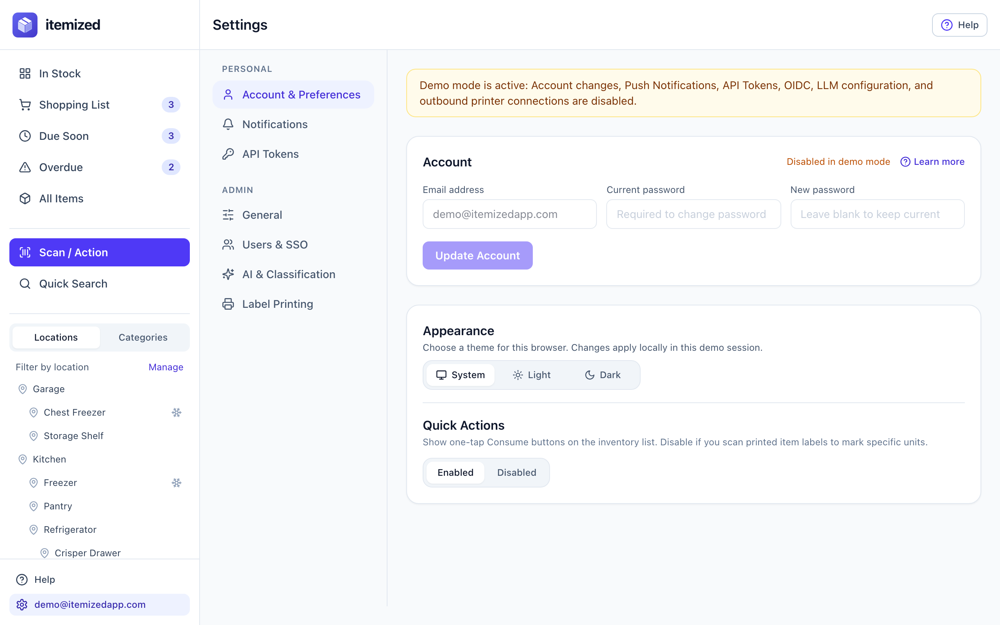

Open **Settings** by clicking your email address in the bottom-left sidebar footer (or visiting `/settings`). Settings is organized into **Personal** and **Admin** panels in the left navigation (or a grouped dropdown selector on mobile). Every card includes a **Learn more** link that opens its matching guide beside the page without discarding unsaved edits.

## Personal panels (all users)

- **Account & Preferences** (`/settings`): Update your email address and password, choose your **Appearance** theme (**System**, **Light**, or **Dark**), and toggle one-tap **Quick Actions** on inventory lists. See [Household accounts and OIDC SSO](accounts-and-sso.md).
- **Notifications** (`/settings?tab=notifications`): Enroll browsers and mobile PWAs for Web Push, send test alerts, and schedule daily **Expiring & Overdue** and **Shopping List** digests. See [Push notifications](push-notifications.md).
- **API Tokens** (`/settings?tab=api-tokens`): Create and revoke long-lived Personal API Tokens for Home Assistant, iOS Shortcuts, and scripts. See [API tokens and Home Assistant](api-tokens-and-integrations.md).

## Admin panels (administrators only)

- **General** (`/settings?tab=general`): Set the **Base URL** encoded in printed QR labels and the **Due Date Rolling Average Count**. See [Inventory and expiration tracking](../use/inventory-and-expiration.md).
- **Users & SSO** (`/settings?tab=users-sso`): Create, promote/demote, or remove household accounts, and configure optional OIDC single sign-on, auto-provisioning, and forced OIDC login. See [Household accounts and OIDC SSO](accounts-and-sso.md).
- **AI & Classification** (`/settings?tab=ai`): Connect Anthropic, OpenAI, Gemini, or local Ollama for automatic UPC normalization and bulk reclassification. See [UPC lookup and AI classification](upc-and-ai.md).
- **Label Printing** (`/settings?tab=printing`): Configure Zebra ZSB (IPP) or Raw TCP (`:9100`) printers and customize Go-template ZPL layouts. See [Label printing and ZPL templates](label-printing.md).

Settings saved in the UI override environment variable defaults; see the [Configuration reference](../self-hosting/configuration.md) for container-only variables.
