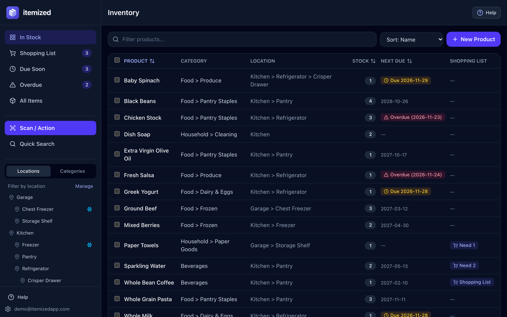

Quick fixes for the most common household and self-hosting issues.

## Mobile camera barcode scanner does not start

Modern mobile browsers (including iOS Safari and Chrome on iOS) block `navigator.mediaDevices` on plain `http://` LAN URLs. Place itemized behind an **HTTPS** reverse proxy (Caddy, nginx, Traefik, or Tailscale Serve) and set `BASE_URL` to your `https://` address. See [Reverse proxy and TLS](../self-hosting/README.md#3-reverse-proxy-and-tls).

## Printed QR labels open the wrong URL

Set **Base URL** in **Settings → Instance Configuration** (or `BASE_URL` in your container environment) to your full HTTPS URL without a trailing slash, then reprint the label.

## Zebra printer test print fails

- Confirm the itemized server can reach the printer's LAN IP and port (`631` for Zebra ZSB IPP, `9100` for Raw TCP ZPL).
- In Docker or Unraid, use bridge or host networking that allows outbound LAN traffic to your printer subnet.
- Verify the printer is powered on and loaded with labels.

## OIDC callback fails

Ensure your identity provider's allowed Redirect URI matches `<BASE_URL>/api/auth/oidc/callback` exactly, and that `BASE_URL` matches the public HTTPS URL you visit in the browser.

## Container cannot write to `/data/itemized.db`

Check that `PUID` and `PGID` match the owner of your mounted host data directory (for Unraid, `PUID=99` and `PGID=100`).
