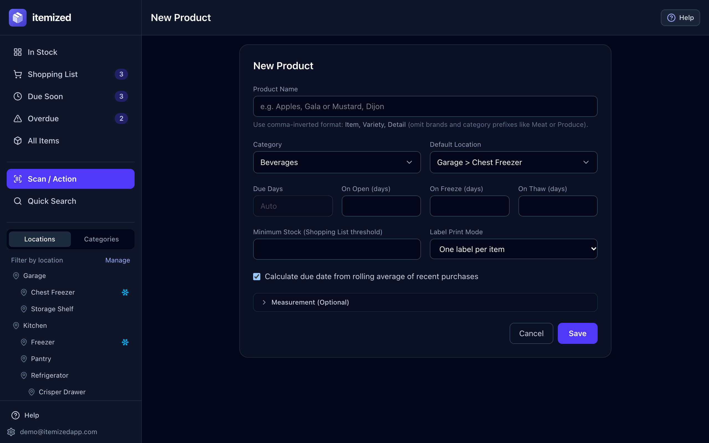

When you scan an unknown retail barcode in **Purchase** mode, itemized looks up the UPC/EAN via **OpenFoodFacts** and pre-fills the product details so you do not have to type everything by hand.

## Configuring optional AI classification

Out of the box, OpenFoodFacts provides raw product titles and brands. To automatically normalize names into your `Item, Variety, Detail` style and suggest the best matching **Category** and **Location**:

1. Open **Settings → Instance Configuration → LLM Product Classification**.
2. Choose a provider: **Anthropic**, **OpenAI**, **Gemini**, or **OpenAI-Compatible (Ollama)**.
3. Enter the **Model name**, optional **Base URL** (for Ollama or self-hosted endpoints, such as `http://ollama:11434/v1`), and **API Key**.
4. Select **Save Settings**.

You can also configure these via environment variables (`LLM_PROVIDER`, `LLM_MODEL`, `LLM_BASE_URL`, `LLM_API_KEY`). See the [Configuration reference](../self-hosting/configuration.md).

## Bulk reclassifying existing products

When an LLM provider is configured:

1. Select one or more products in the desktop inventory table.
2. Click **Reclassify** in the floating bulk actions bar.
3. Review the suggested standardized names in the **Reclassify Products** modal. Edit any target name, uncheck rows you want to skip, and check live **Rename** or **Merge** badges.
4. Confirm to apply all selected changes in one batch.
