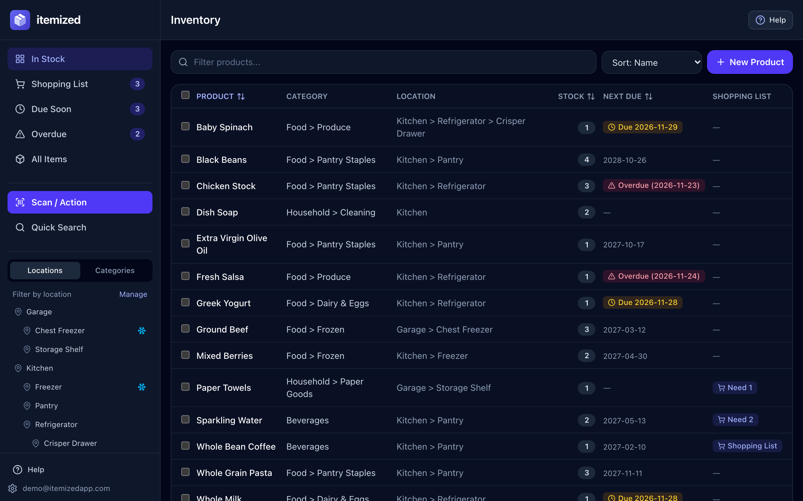

Demo mode lets anyone explore itemized without creating an account or affecting a production database. The public demo is available at [demo.itemizedapp.com](https://demo.itemizedapp.com).

## What is included

- **No login required**: Visitors are signed in automatically as the demo household administrator.
- **Sample household data**: Pre-seeded locations (*Kitchen*, *Pantry*, *Fridge*, *Freezer*), categories, products, variants, barcodes, and in-stock/due-soon/overdue items.
- **Hourly reset countdown**: A banner below the header shows when sample data will reset back to its clean baseline.

## Sandboxed actions in demo mode

To keep public demos safe, outbound integrations and destructive account edits are sandboxed:

- Account email and password changes are disabled.
- OIDC and LLM settings cannot be modified, and outbound LLM calls are disabled.
- Outbound Zebra IPP and raw TCP printer connections are simulated instead of reaching LAN hosts.
- Live OpenFoodFacts UPC lookups are rate-limited to 5 requests per minute.

## Run demo mode locally

Administrators can enable demo mode on any instance by setting `DEMO_MODE=true` (and optionally `DEMO_RESET_INTERVAL=1h`). See the [Configuration reference](../self-hosting/configuration.md).
