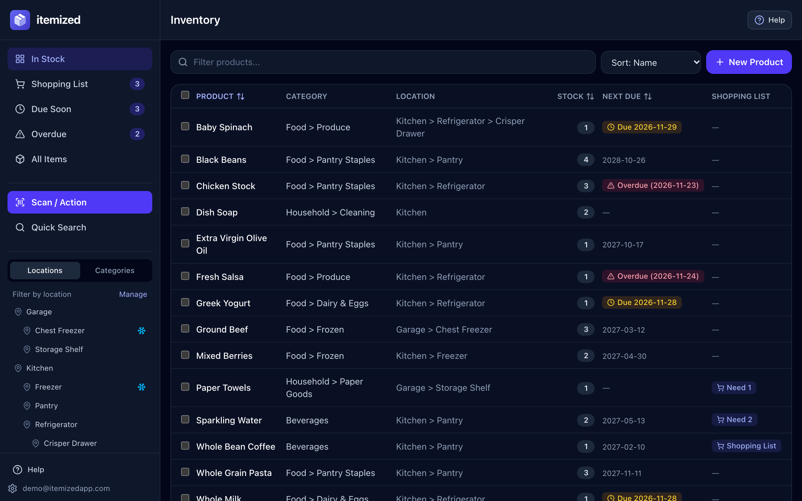

Get from a fresh itemized instance to tracking your pantry, fridge, and freezer in a few minutes.

## Create your administrator account

When you open itemized for the first time, the setup screen prompts you to create the initial **Admin** account with an email address and password (at least 8 characters). You can add other household members or configure OIDC later in [Accounts and SSO](../use/accounts-and-sso.md).

## Set up a few locations and categories

Open **Locations** or **Categories** from the sidebar to create your main storage areas—for example, *Kitchen → Pantry*, *Kitchen → Fridge*, and *Garage → Chest Freezer* (mark freezer locations with the **Freezer** toggle so automatic freeze/thaw due dates work).

## Add your first product

1. Press `n` (or select **+ New Product**) to open the New Product form.
2. Enter a clear name following the `Item, Variety, Detail` style (such as *Milk, Whole, Organic*). Itemized checks for similar existing products as you type to prevent duplicates.
3. Choose a **Category**, **Default Location**, and optional **Minimum Stock** level.
4. Leave **Calculate due date from rolling average of recent purchases** checked, or uncheck it to set a fixed number of days.
5. Select **Save Product**.

## Record stock with Scan / Action

Select **Scan / Action** from the sidebar (or the bottom dock on mobile), stay in **Purchase** mode, and scan a retail barcode or pick your product. Enter the quantity, confirm the location and due date, and submit.

## Review your dashboard

Use the sidebar filters to see what is **In Stock**, what is **Due Soon** or **Overdue**, and what needs restocking on your **Shopping List**.
