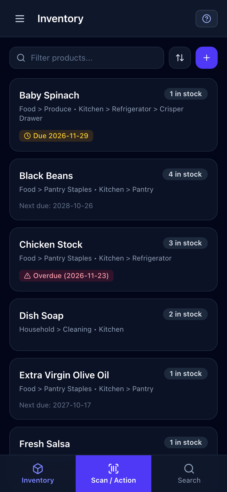

Itemized ships as an installable Progressive Web App (PWA) designed for one-handed use at the grocery store or in front of your pantry.

## Before you install

Mobile browsers disable live camera barcode scanning on plain `http://` LAN URLs. Make sure your instance is served over **HTTPS** behind a reverse proxy before installing it on your phone. See [Self-hosting: Reverse proxy and TLS](../self-hosting/README.md#3-reverse-proxy-and-tls).

## Install on iOS (Safari)

1. Open your itemized HTTPS URL in **Safari**.
2. Tap the **Share** button in the Safari toolbar.
3. Scroll down and tap **Add to Home Screen**.
4. Confirm the name (**itemized**) and tap **Add**.

Launching from the home screen opens itemized full-screen with safe-area support and no browser chrome.

## Install on Android (Chrome)

1. Open your itemized HTTPS URL in **Chrome**.
2. Tap the **Install app** banner, or open the three-dot menu and choose **Add to Home screen**.
3. Confirm **Install**.

## Offline Help on mobile

Once loaded, itemized's in-app Help center works offline so you can check workflows or keyboard shortcuts even without a signal.
