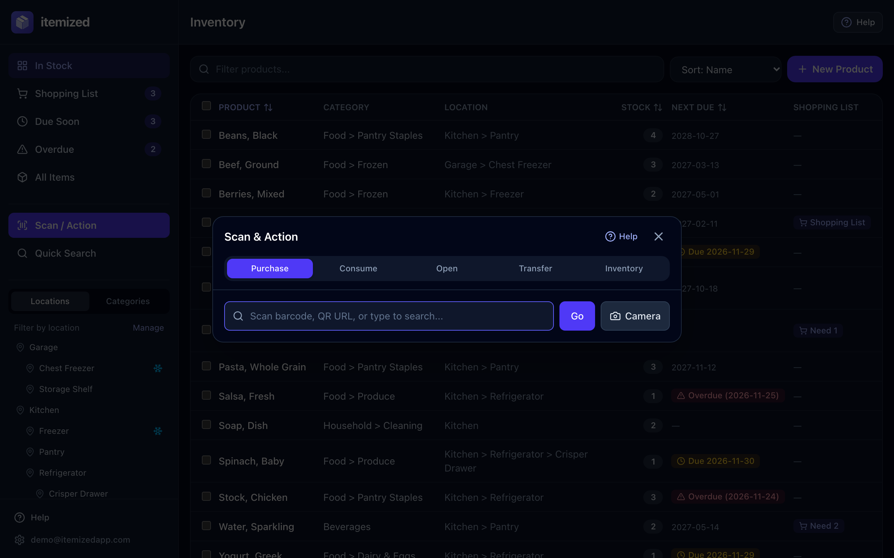

The **Scan / Action** drawer is the fastest way to update inventory using either your phone's camera or a USB/Bluetooth barcode scanner.

## Supported barcodes

Itemized decodes retail barcodes (UPC-A, UPC-E, EAN-13, EAN-8) as well as itemized's own printed QR codes for items (`/go/i/:id`), products (`/go/p/:id`), and locations (`/go/l/:id`).

## Scanning printed QR codes with your phone camera

Pointing your phone's native camera app at any printed itemized QR code opens a mobile-first **QR Quick Action** screen directly at `/go/i/:id`, `/go/p/:id`, or `/go/l/:id`—no need to open the scanner drawer first:

- **Item QR (`/go/i/:id`)**: One-tap **Consume** (with **Undo**), **Open** (applying Days After Opening with **Undo**), **Transfer** to another location, **Shopping List** toggle, or **Restore / Unconsume** if already consumed.
- **Product QR (`/go/p/:id`)**: One-tap **Consume Next** (soonest-due unit, with **Undo**), per-item **Consume / Open / Transfer**, **Quick Add (+1)** restock, and **Shopping List** toggle.
- **Location QR (`/go/l/:id`)**: Lists every in-stock item in that location (with quick filtering and clickable **Sub-locations** chips) so you can **Consume**, **Open**, or **Transfer** items directly from the shelf or freezer.

## Five scanning workflows

Open **Scan / Action** from the sidebar or mobile bottom dock and select a mode:

- **Purchase**: Scan a retail barcode or product QR to add new in-stock items, pick quantity, location, due date, and optional label printing. Unknown retail barcodes automatically query OpenFoodFacts (see [UPC lookup and AI classification](../configure/upc-and-ai.md)).
- **Consume**: Scan an item QR or retail barcode to mark the soonest-due matching item as consumed.
- **Open**: Scan an item or product to mark it opened and apply its **Days After Opening** rule.
- **Transfer**: Scan a destination **Location** QR (or pick one), then scan items to move them there—automatically applying freeze or thaw due-date rules when moving into or out of a freezer.
- **Inventory Audit**: Scan a **Location** QR, then scan every item physically present in that location. Review the summary to reconcile missing or unexpected items in one step.

## Using a USB or Bluetooth scanner

With **Scan / Action** open, focus the manual barcode field and scan. Most HID scanners type the barcode followed by `Enter`, which resolves immediately without touching the camera.
