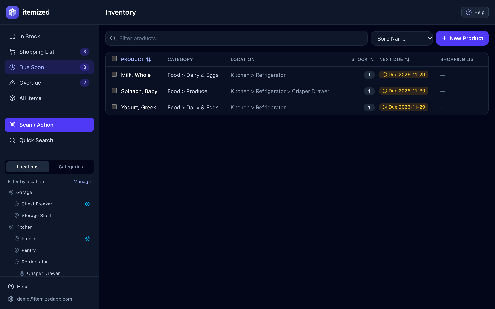

Itemized tracks individual physical **Items** under each **Product** so you always know what expires next and where it is stored.

## Inventory views and sorting

Use the sidebar filters to switch between:

- **In Stock**: Products with at least one unconsumed item.
- **Shopping List**: Low-stock or manually pinned products.
- **Due Soon**: Items approaching their due date.
- **Overdue**: Items past their due date.
- **All Items**: Every product in your catalog, including out-of-stock products.

Filter any view by **Location** or **Category** from the sidebar tree, or sort by **Name**, **Soonest Due**, or **Stock Count**.

## Smart expiration and due-date rules

Itemized calculates due dates automatically when you add, open, freeze, or thaw items:

- **Rolling-average due days**: Enabled by default on new products (`~X` days on the Product detail page), computed from the average shelf life of your recent purchases. Configure how many recent purchases are averaged under **Settings → Instance Configuration** (**Due Date Rolling Average Count**).
- **Fixed due days**: Uncheck the rolling-average option on a product to enter a manual **Default Due Days** value.
- **Open, freeze, and thaw rules**: Set optional days-after-opening, days-after-freezing, and days-after-thawing on a product. Marking an item **Open** or transferring it into or out of a **Freezer** location recalculates its due date automatically.

## Managing individual and bulk items

On the inventory list, in-stock products display a **Consume** quick-action button on both mobile cards and desktop table rows so household members can log a consumed unit with one tap. Quick consume always marks the soonest-due item consumed (with unset due dates last, breaking ties by oldest item) and shows an **Undo** toast in case of an accidental tap. Power users who prefer scanning printed QR labels to mark exact units can disable **Quick Actions** per account under **Settings**.

Open any product to inspect its metadata, optional **Measurement** (volume, weight, or length), variants, barcodes, and individual items. Select checkboxes on multiple items to **Consume**, **Open**, **Transfer**, **Set Due Date**, **Set Variant**, or **Reprint Labels** in one action.
