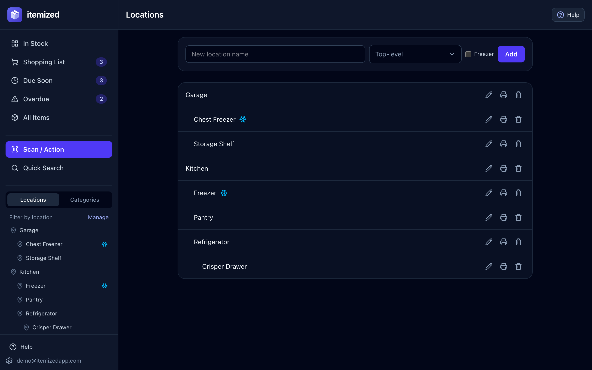

Locations and categories let you mirror how your home is actually organized, from broad rooms down to specific shelves or drawers.

## Nesting locations and categories

1. Open **Manage** next to **Locations** or **Categories** in the sidebar (or visit `/locations` or `/categories`).
2. Enter a name and optionally pick a **Parent** using the hierarchical drill-down selector (for example, *Kitchen → Refrigerator → Crisper Drawer*).
3. Select **Add** to create the node.

To reorganize later, click **Edit** on any row to rename it or move it under a different parent (or choose **Top-level** to clear its parent). Itemized prevents moving a node under itself or one of its own descendants.

## Marking freezer locations

Check **Freezer** on any location that stores frozen food (such as a chest freezer or fridge freezer compartment). Freezer locations display a snowflake icon in the sidebar and automatically trigger your products' **Days After Freezing** and **Days After Thawing** rules whenever items are transferred in or out.

## Filtering by location or category

Switch between the **Locations** and **Categories** tabs in the sidebar and click any entry to filter the inventory list. Click the active entry again to clear the filter.

## Printing location QR labels

Open any location's detail page (`/locations/:id`) and select **Print Label** to print a scannable location QR code. Scanning that QR code in **Scan / Action** sets the target location for **Transfer** or **Location Inventory Audit** workflows.
