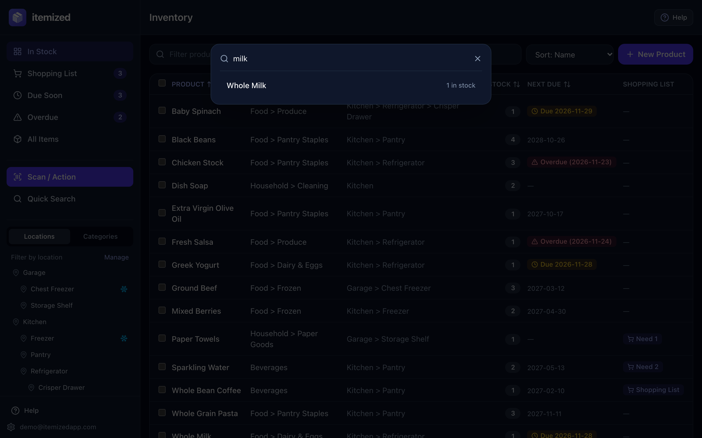

Itemized uses SQLite FTS5 trigram indexing so you can find products even with partial words or minor typos.

## Quick Search and mobile Search

- **Desktop**: Click **Quick Search** in the sidebar to open the search modal, type a partial product name, and click a result to jump directly to its detail page.
- **Mobile**: Tap **Search** in the bottom dock to open the dedicated `/search` view. Navigating back from a product detail page restores your previous query and results automatically.

## Keyboard shortcuts

Press `?` anywhere outside an input field to toggle the keyboard shortcuts cheat sheet, or press `g` then `?` to open the full in-app Help center.

<!-- GENERATED:SHORTCUTS -->
