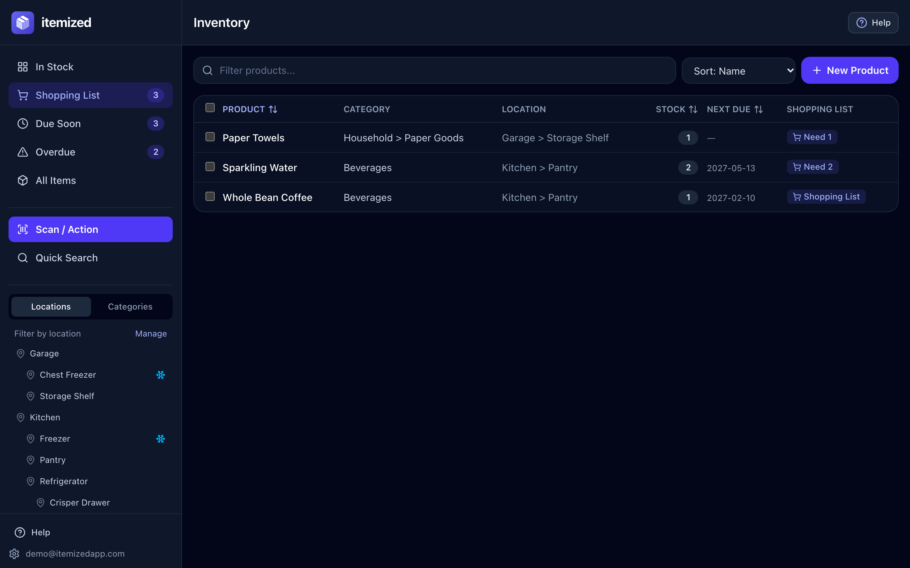

Itemized maintains an automatic **Shopping List** so you never have to copy low-stock items into a separate grocery app.

## Automatic low-stock triggers

Set a **Minimum Stock** count on any product (for example, `2` for milk or `4` for diced tomatoes). Whenever the number of unconsumed items drops below that minimum, the product appears automatically on the **Shopping List** (`g s`) and updates the sidebar badge count.

## Adding or removing items manually

Even if a product has no minimum stock set (or is still above its minimum), you can toggle it onto the Shopping List with one click from its product detail page or inventory actions.

## Automatic clearing on restock

When you record a **Purchase** (via **Scan / Action** or by adding items on the product page) and the product's in-stock count meets or exceeds its minimum stock, itemized automatically clears its manual shopping-list flag so it disappears from your Shopping List without extra taps.
