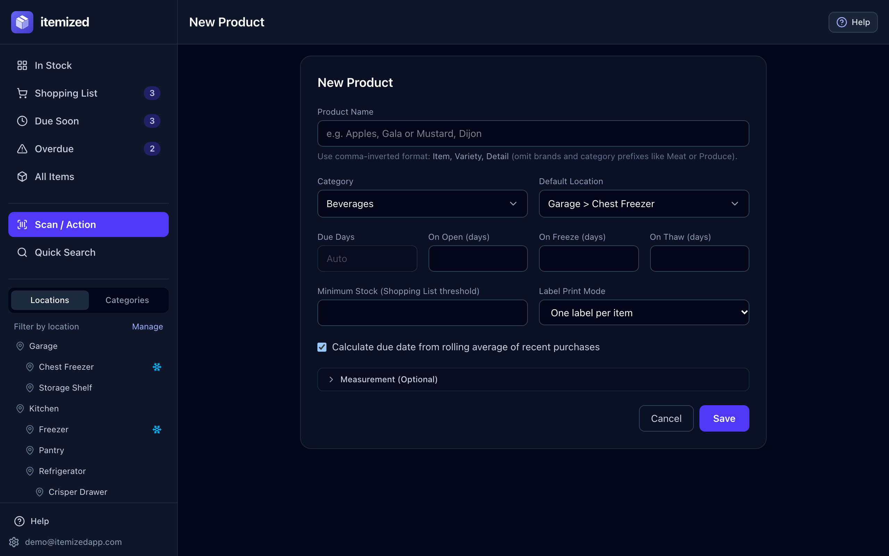

Products represent the generic household item you track (such as *Tomatoes, Diced*), while **Variants** represent specific brands or package sizes (such as *Muir Glen 14.5 oz* or *Kirkland Organic 14.5 oz*).

## Adding variants and barcodes

1. Open any product's detail page (`/products/:id`).
2. Under **Variants**, add a variant name (brand, flavor, or size).
3. Attach one or more retail UPC/EAN barcodes to that variant. When you scan any attached barcode in **Scan / Action**, itemized automatically selects both the product and the exact variant.

You can also assign or change the variant on existing in-stock items using the bulk selection bar on the Product detail page.

## Merging duplicate products

If you accidentally created two products for the same item (for example, *Black Beans* and *Beans, Black*):

1. On the desktop inventory table, select the checkboxes for two or more products.
2. Click **Merge** in the floating bulk actions bar to open the **Merge Products** dialog.
3. Choose the target product to keep and confirm.

Itemized moves all items, variants, and barcodes from the merged products into the target product without losing purchase history.
